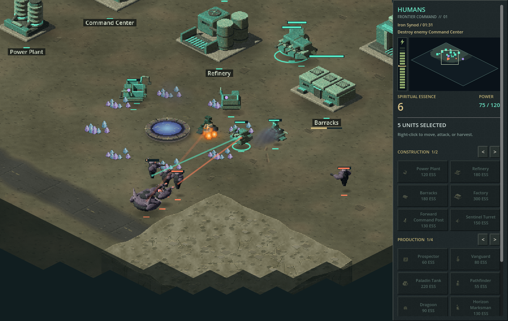
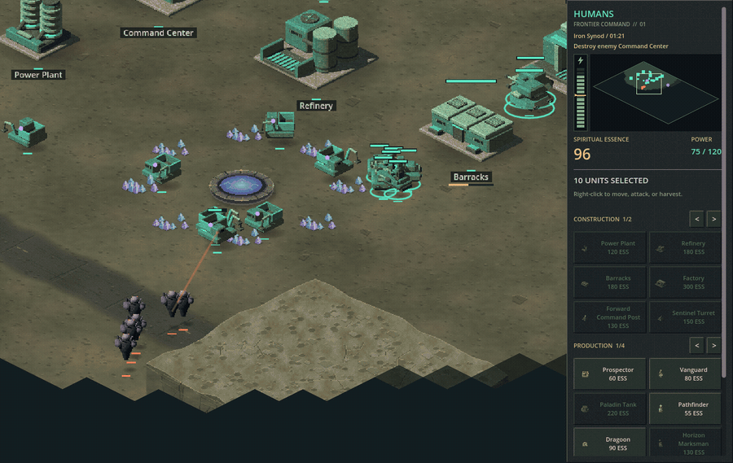
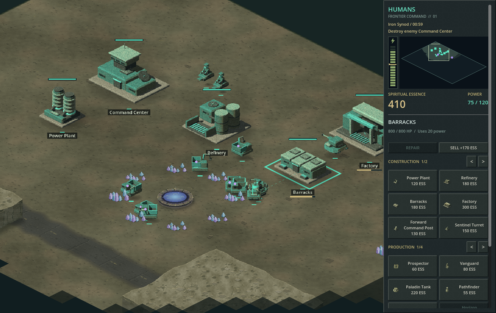
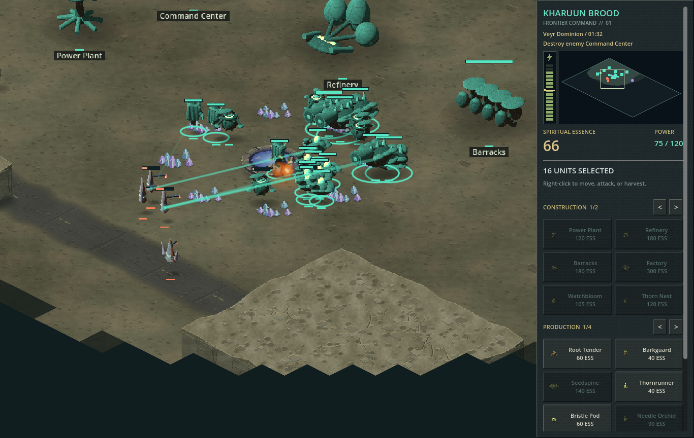

# CommandPower — The Silent Wells

**This project is 100% AI built.** It was created to demonstrate **agent context management** across an evolving game project: keeping design decisions, faction rules, implementation, assets, and verification consistent as work moves between agent sessions. Humans supplied direction and feedback; AI agents authored the game code, project documentation, and asset-generation workflows. The project uses Godot and other third-party tools and dependencies, credited below.

A single-player, isometric 2D real-time strategy demo set in 35,000 AD. Choose Humans, Iron Synod, Kharuun Brood, Veyr Dominion, or either Aetherbound host against any AI faction. Build a base, harvest regenerating spiritual essence around ancient wells, produce faction-specific armies, and destroy the enemy Command Center. Original pre-rendered sprites, worn industrial materials, textured wasteland terrain, and a gunmetal sidebar give the 2:1 battlefield a classic late-1990s RTS look.

## Gameplay gallery

Captured in-game on Ashen Crossing, with normal resource costs, production timers, combat, and fog of war.

**Defending the wells:** Human hover units exchange laser fire with an Iron Synod raid while Prospectors keep the base supplied.



**See it in motion:** a 15-second gameplay clip showing the raid unfold. Click the looping preview to open the full-resolution MP4. The clip is silent.

[](docs/media/defending-the-wells.mp4)

[Watch or download the gameplay video (MP4)](docs/media/defending-the-wells.mp4)

| Building the economy | Faction warfare |
|---|---|
|  |  |
| Harvest essence, deliver cargo, and expand production. | Kharuun Brood and Veyr Dominion bring distinct silhouettes to the battlefield. |

## Quick start

On Linux x86-64 with OpenGL 3.3, install Git, Bash, curl, unzip, and zip, then run:

```bash
git clone https://github.com/horvatic/CommandPower.git
cd CommandPower
./scripts/setup-engine.sh
./run.sh
```

The setup script downloads Godot 4.5.1 stable into `.tools/`; no system-wide engine installation is needed. Runtime art and audio are included, so Python and speech models are only needed when regenerating assets.

## Agent context management

The repository keeps durable context alongside the implementation:

- [AGENTS.md](AGENTS.md) defines agent scope, constraints, and verification rules.
- [docs/DESIGN.md](docs/DESIGN.md) records mechanics, formulas, presentation specifications, and performance targets.
- [docs/Factions.md](docs/Factions.md) preserves faction identities, rosters, and prerequisites.
- `./scripts/project-context.sh` checks file availability, the engine version, and Git status at the start of a session.
- [tests/](tests/) provides repeatable checks for mechanics, UI, and assets.

These files make decisions available to subsequent sessions and help agents work within a defined scope. The playable demo is the result of that context-management exercise.

## Presentation and audio

Mobile units use legless hover platforms, enclosed chassis, floating pods, or suspended spirit/crystal forms. They look complete as static sprites and move through translation and directional facing changes, without walk or wing-flapping cycles. Hovering is visual only; normal ground navigation still applies.

The battlefield fills the window height and expands to fit fullscreen or resized displays without black borders. Mouse-edge scrolling follows the actual display edges, with a consistent 16-pixel activation band. In windowed mode, the title bar and resize borders also trigger scrolling; moving outside the window stops it. A segmented power meter beside the sidebar radar shows supply bars and a demand marker, turning amber near capacity and red during a power shortage. Exact power usage remains visible below the radar.

Workers, frontline units, and heavy units have distinct body shapes and equipment within every faction: collection tools and cargo bodies, armored combat silhouettes, and substantial heavy weapon platforms. All eight facing views and sidebar thumbnails use the updated artwork.

A gentle up-and-down hover bob gives mobile units motion while their shadows stay on the ground. It pauses with the simulation and needs no walk-cycle artwork.

The Human Prospector uses a wheel-free hover hull. The Vanguard shows a human operator in an open hover vehicle, with the lower body concealed inside the cockpit. The Paladin Tank uses a swept armored hovercraft hull with recessed lift machinery and rear thrusters, without treads or wheels.

The original soundtrack, **Iron Horizon**, is a **5-minute 52-second** industrial rock/electronic suite. It develops through distinct grooves, changing riffs and harmonies, melodic themes, an ambient breakdown, a gradual rebuild, and a final advance before returning to the opening atmosphere. Syncopated bass, heavy drums, metallic percussion, organ and brass-like synths, and spacious textures change throughout the arrangement. The stereo track loops through the deployment screen and battle, including pause and match results. Press **M** or use the sidebar music button to mute or resume music; your choice lasts until you close the game.

Selecting units and issuing movement or attack orders play unit-specific acknowledgments, with three variations per applicable action. Only Human units use spoken dialogue; all existing Human lines are preserved, including **“For the People's Republic!”** Each other faction uses a distinct wordless theme across its full roster: cybernetic resonance for the Iron Synod, living grove sounds for the Kharuun, celestial choir/organ/bells for the Heavenly Host following the Seraph Guard, abyssal growls and breath for the Infernal Legion, and crystal resonance for the Veyr. Unarmed support units acknowledge selection and movement; armed units also acknowledge direct attacks and attack-move orders. Groups play one response, and repeated clicks do not stack acknowledgments. Each response finishes naturally; new orders still execute immediately without cutting off the current line. **M** controls music independently of unit acknowledgments.

Weapons fire laser pulses: infantry use sharp bursts, and tanks use heavier discharges. Sounds follow actual shots from visible on-screen units on either side. Dense volleys share a bounded sound mix so a large battle does not create an unlimited audio pileup.

A single command announcer reports **“Building units,” “Unit under attack,” “Building under attack,” “Unit lost,”** and **“Building constructed.”** The same voice also covers construction started, units ready, building losses, insufficient essence, low/restored power, cancelled training, blocked production exits, invalid placement, and match results. Announcements wait for the current unit response or announcement to finish. Important warnings take priority among waiting messages, and repeated events are coalesced. Construction adds industrial assembly and completion sounds. The **Unit voices** slider controls both unit responses and the announcer; **Sound effects** controls weapons and construction.

Open **SETTINGS** from the title/results screen or **Settings / Pause** from the sidebar, then select **Audio** to adjust **Music**, **Unit voices**, and **Sound effects** independently from **0–100%**. Changes apply immediately. **M** mutes music and restores your chosen music level when unmuted. Volume choices last for the current session, including match restarts. Opening settings during a match pauses play and preserves active voices and effects so they continue on resume. **RESUME** returns to play; **Esc** restores the previous pause state. **RESTART** and **MAIN MENU** are inside this menu and ask for confirmation before discarding a running match. The **MUSIC ON/OFF** button is on the Audio tab.

## Play

For a downloaded Linux package, keep the entire folder together and run `./play.sh`. The engine is included; no separate Godot installation is needed.

From the title screen, choose **SKIRMISH**, select a battlefield, your faction, the AI faction, and separate army colors, then choose **Easy**, **Normal**, or **Hard** and start the match. Heavenly Host and Infernal Legion are separate Aetherbound choices; mirror matches are supported. Choose **Ashen Crossing** (small, 72 × 48 tiles), **The Silent Wells** (medium, 96 × 64; the default), **Shattered Basin** (large, 128 × 96), or **Frontier Reach** (huge, 160 × 112). All maps have equal starting unit counts and 900 essence per side. Eight selectable army colors distinguish opponents even when both choose the same faction; choosing a duplicate automatically gives the other commander a different color. Easy expands slowly and attacks later; Normal uses balanced pressure; Hard expands faster and attacks earlier and more often. All levels use the same faction stats, starting resources, costs, build times, and fog-of-war rules as the player; difficulty grants no combat or economy bonuses. Restarting keeps your chosen map, factions, colors, and difficulty. **MAIN MENU** confirms before leaving a running match; the results screen offers a fresh skirmish setup.

From source, run `./scripts/setup-engine.sh` once, then `./run.sh`. Development requires Godot 4.5.1 stable; the setup script installs the Linux x86-64 engine locally in `.tools/`.

## Controls

All bindings are fixed and cannot be changed. View them in **Settings → Controls**.

| Action | Control |
|---|---|
| Select | Left-click; drag a box to select units |
| Add to selection | Shift + left-click or drag |
| Move, attack, harvest, or set rally point | Right-click the destination or target |
| Attack-move | E, then left-click a destination |
| Stop / hold position | X / H |
| Save / recall a control group | Ctrl + number / number |
| Move camera | WASD, arrow keys, battlefield/window edges, or middle-mouse drag |
| Focus selection | F |
| Zoom | Mouse wheel |
| Pause / resume | Space; Settings / Pause opens the paused settings menu, then Resume returns to play |
| Music on / off | M or Settings → Audio → Music On/Off |
| Music, voice, and sound effects volume | Settings → Audio |
| Cancel current action | Escape |
| Repair / sell a building | Select one friendly building, then use Repair / Sell in the sidebar |
| Build structures | Right sidebar |
| Train units | Click a unit icon in the right sidebar; owning its completed production building is required |

Workers collect essence growth around spiritual wells and deliver cargo to a friendly Refinery or Command Center. Currency is credited on delivery. Harvested growth gradually returns. All unit and building costs use the same essence resource; there is no artificial army cap. Train directly from the sidebar without selecting a building: own a Command Center for workers, Barracks for infantry, or Factory for tanks. Each unit requires its completed producer, any listed completed technology structures, and its essence cost. Tooltips show the requirements before spending. Prerequisites are checked when queued; a paid order continues if another technology structure is later lost. Refineries use 15 power, Barracks 20, and Factories 40; Command Centers supply 20 and Power Plants 100. Power shortages halve training speed while still allowing units to be queued.

Workers automatically return to harvesting when they finish construction, keeping any carried essence and delivering a full load before collecting more.

Select a damaged, completed friendly building and click **REPAIR** to restore it over time using essence; click **STOP REPAIR** to stop. Repair averages 2% maximum HP per second in 1-essence pulses and waits when funds run out. A full repair costs half the building price, rounded up for a partial pulse. **SELL** removes the selected building for half its price scaled by remaining health, rounded down, plus full refunds for its queued units. Incomplete structures can be sold too. Selling your Command Center requires confirmation and ends the match in defeat.

Every independently selectable side fields **21 units and 13 buildings**, including its original three units/five structures plus **18 new units and eight new buildings**. Heavenly Host and Infernal Legion have independent full rosters. New units have faction-specific names, silhouettes, weapons/support abilities, stats, prices, prerequisites, and unit-specific audio acknowledgments. The sidebar pages through construction and production catalogs without shrinking the battlefield. Combat styles and counters are:

| Side | Playstyle | Main weakness |
|---|---|---|
| Humans | Piercing specialists and compact support wards | Needs combined arms to cover specialist weaknesses |
| Iron Synod | Rapid hybrid fire, disengagement regeneration, and structure repair | Costly replacements; heavy armor blunts smaller hits |
| Kharuun Brood | Cheap regenerating swarms and sap/pollen area denial | Fragile individuals; armor blunts small attacks |
| Heavenly Host | Defensive elites protected by strong wards and healing | Slow and costly; support formations can be flanked |
| Infernal Legion | Fast assaults with damage-draining specialists | Fragile and short-ranged; vulnerable to focused fire |
| Veyr Dominion | Armored piercing siege and gravity suppression | Very slow and expensive; close raids punish siege |

Iron Synod frontline and heavy units trade larger single hits for rapid fire and improved durability. Their higher costs reward careful advances and preserving units; heavily armored targets reduce the efficiency of their repeated small hits. Every faction follows ordinary fog of war: enemies on currently visible terrain can be seen and targeted, regardless of proximity or recent firing. The AI follows these same rules.

The original worker economy, five building roles, starting forces, and baseline combat units remain intact. New structures provide forward observation, anti-light and anti-heavy defenses, three specialist producers, advanced power, and faction-specific positional support. Units now fill scouting, anti-light, anti-armor, siege, assault, healing, repair, ward, and slowing roles. Healers and repair units restore one eligible ally at a time; wards use the strongest emitter and do not stack. Weapons with a minimum range need an escort, and siege attacks require ordinary shared vision. No faction gains free income or units, a population cap, flight, resurrection, or special concealment. Exact values and counters are recorded in `docs/DESIGN.md`, `docs/Factions.md`, and `scripts/roster_data.json`. Balance checks compare equal spending and counter matchups; ongoing playtesting remains useful. Campaigns, portals, manual spells, upgrades, and saves remain outside this demo.

## Build and verify

From the repository root:

```bash
./scripts/setup-engine.sh
./tests/run.sh
./scripts/build.sh
```

The build creates `dist/CommandPower-linux-x86_64/` and `dist/CommandPower-linux-x86_64.zip`. Run the package with `./dist/CommandPower-linux-x86_64/play.sh`. Tests and builds use isolated temporary profiles and do not alter player data. Close any running packaged game before rebuilding.

The source repository includes runtime assets, Godot import settings, resource IDs, authoring scripts, tests, and documentation. Downloaded engines (`.tools/`), Godot caches (`.godot/`), preview output (`artifacts/`), Python caches, and packaged builds (`dist/`) are excluded from version control. Distribute the generated ZIP as a GitHub Release asset when publishing a playable build.

## Asset authoring

The generated artwork is already included. To change sprite models/materials, edit `scripts/sprite_models_3d.gd`, run `.tools/godot --path . --script res://scripts/bake_sprites.gd` with a graphical renderer, import the resources, and rebuild. Append `-- --buildings-only` to update only building artwork, `-- --units-only` to leave the building atlas untouched, or `-- --human-units` to update only the Prospector and Vanguard. Terrain artwork can be regenerated with `python3 assets/terrain/generate.py` using NumPy and Pillow. Use `-- --expansion` to regenerate only the additional faction models without touching the original atlases. Neither authoring step is required to play the demo.

The included music needs no authoring dependencies to play. Regenerate it with `python3 assets/music/generate.py` using NumPy and a system libsndfile with Ogg/Vorbis support, then import resources and rebuild. Synthesis and effects are rendered offline; runtime playback uses the compressed Ogg stream.

Unit audio is also included as compressed Ogg files. `assets/voices/manifest.json` records Human dialogue and all faction cue variants; `assets/voices/expansion_manifest.json` identifies the expanded units. All non-Human unit acknowledgments use procedural wordless faction sounds. Regenerate the non-Human themes with `python3 assets/voices/revoice_factions.py`; no speech models are required. Human speech authoring remains available through `python3 assets/voices/generate.py --model-dir /path/to/models` and `python3 assets/voices/generate_expansion.py --model-dir /path/to/models`. The credited Human speech models and authoring dependencies are listed in `assets/voices/CREDITS.txt`. Speech generation and all sound processing run offline; playing the game needs no speech model, network connection, or extra tool installation.

Laser and construction sounds are original synthesized assets in `assets/sfx/`; regenerate them with `python3 assets/sfx/generate.py` using NumPy and libsndfile, then import resources and rebuild. Generate the announcer with `python3 assets/announcer/generate.py --model-dir /path/to/models` using the same speech-authoring dependencies. All 17 lines use one voice model and processing preset; their transcript is in `assets/announcer/manifest.json`.

## Notices

Original game code, artwork, and music are covered by `LICENSE`. Godot is distributed under its MIT license; packaged builds include `GODOT-LICENSE.txt` and `GODOT-COPYRIGHT.txt` for its engine and third-party notices. Command & Conquer is a visual and genre reference; this demo uses original game assets. The soundtrack draws on the industrial rock/electronic RTS tradition associated with Frank Klepacki, using original composition and synthesis.

Unit and announcer audio use original dialogue and sound design. Speech-model provenance is recorded in `assets/voices/CREDITS.txt` in source and `VOICE-CREDITS.txt` in the Linux package.
